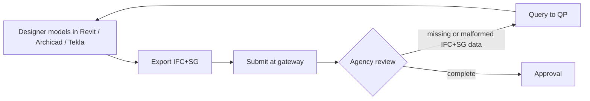
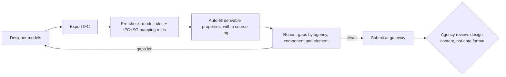

# Where a pre-check fits in the CORENET X submission process

CORENET X groups building-plan approvals into gateways:

- **G1 Design**
- **G1.5 Piling**
- **G2 Construction**
- **G3 Completion**

At each gateway, one coordinated IFC+SG model goes to all the regulatory agencies together. The IFC+SG data each agency needs is set out in BCA's Industry Mapping; the version used here is dated 4 December 2025.

## As-is: gaps are found by the reviewer

The pain points are:

- **Missing data is found late.** A missing `SGPset_DoorDimension.ClearWidth` or a wrongly formatted `FireRating` is found only after submission, at the agency's review. Each finding costs a query-and-resubmit cycle.
- **The requirements live in a spreadsheet.** They are in an Excel mapping of 833 rows (entity, sub type, property set, property, accepted values, agency), and the designer has to cross-check by hand.
- **Existing data is typed twice.** Values the model already holds are often re-entered by hand: sizes in the geometry, concrete class in a standard property set.

## To-be (proposed): check and auto-fill before submission

The steps are:

1. **Pre-check.** Run the checker on the exported IFC. It checks the model level (units, a single site and building, named storeys, containment, georeference, IFC4) and every applicable row of the mapping, and it can filter by agency.
2. **Auto-fill.** Fill only what can be derived with a traceable source:
   - dimensions from geometry, measured square to the member axis;
   - marks from the tag or name;
   - concrete grade (EN 206 pair) and construction method from `Pset_ConcreteElementGeneral`.

   Every value goes into a CSV log so the designer can review it. Existing values are never overwritten.
3. **Report.** The designer gets a list grouped by agency and component, with the elements that have the most gaps. The designer fixes what is left and re-runs the check.
4. **Submit.** The model goes to the gateway with the data format already checked, so review time goes on design content.

## What was measured on real models

The rules come from BCA's IFC+SG mapping of 4 December 2025, and the numbers from `reports/summary.json`.

| Model | Elements | Element-rule checks | Pass before | Values auto-filled | Pass after | Time |
|---|---|---|---|---|---|---|
| facade-bim (IFC4, unitised curtain wall) | 859 | 208 | 0% | 18 | 13.0% | 13 s |
| bridge-bim (IFC 4.3, 12-span T-girder bridge) | 1,470 | 27,249 | 0% | 5,136 | 17.8% | 60 s |

- **The auto-filled sizes match the design values.** On all 120 T-girders, beam depth and width come out at 2,000–2,001 mm and 1,850 mm; bridge-bim's design section is 2.00 m by 1.85 m. The facade slabs come out at 250 mm, as in the model's export script.
- **Both models start at 0% by design.** Neither was authored for CORENET X, and the bridge is not a CORENET X building submission. They are used because they are real, independently built models.
- **What remains needs the designer.** The unfilled items are those a model does not hold: reinforcement details, connection types, slab type. The report lists them so the designer knows exactly what to add.
- **Time.** On a laptop, checking, auto-filling and re-checking the bridge model took about a minute.

## Rolling this out (change management)

- **Start where the rules are settled.** Begin with the property sets whose accepted values are fixed lists, such as `FireRating`, `ConstructionMethod` and `MaterialGrade`. The mapping itself says it is a work in progress, so rules should follow its version, and the change log sheet shows what moved.
- **Put the check in the designer's loop, not the agency's.** A report grouped by element GlobalId can be opened next to the authoring tool.
- **Keep auto-fill conservative and logged.** A derived value that is wrong is worse than a gap, so each derivation is validated against design values before it is enabled, as the girder depths above were.
